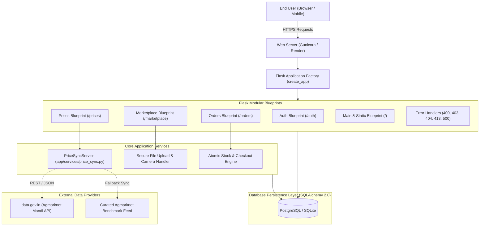
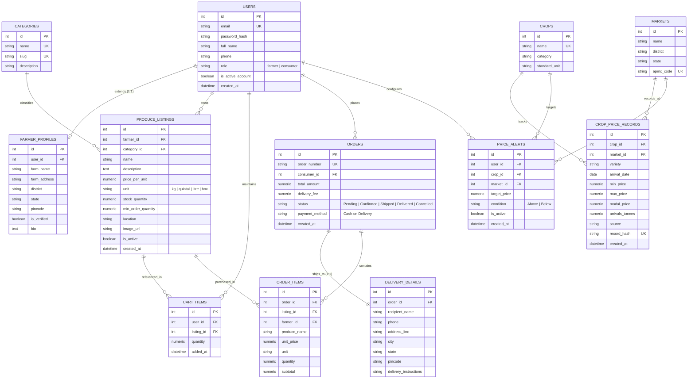
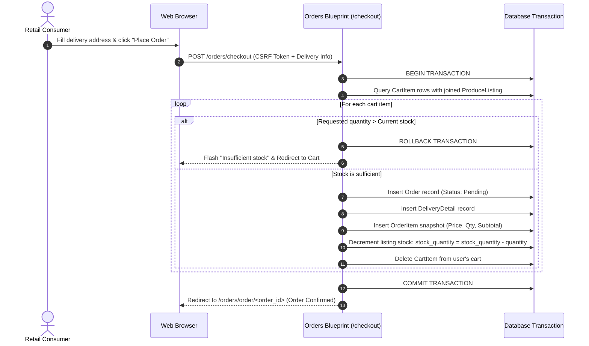

# AgriConnect: Integrated Direct Farmer-to-Consumer Agricultural Marketplace and APMC Mandi Price Intelligence Platform

**Academic Capstone Project Report**  
**Course:** Integrated Professional Engineering (IPE) Project  
**Institution:** Marwadi University / College — Faculty of Engineering & Technology  
**Department:** Computer Engineering / Information Technology  
**Academic Year:** 2026  

---

## Executive Summary & Abstract

In traditional Indian agricultural marketing, growers are separated from retail consumers by multi-layered intermediary supply chains, commissions, and non-transparent auction mechanisms. Consequently, farmers frequently receive less than 30% of the terminal consumer rupee, while consumers pay substantial retail premiums for perishable produce. Furthermore, daily wholesale commodity prices announced across regional Agricultural Produce Market Committee (APMC) mandis remain fragmented, hindering farmers' bargaining power and post-harvest dispatch decisions.

**AgriConnect** is an integrated full-stack web application designed to solve these systemic inefficiencies through two interconnected modules:
1. **Direct Farmer-to-Consumer E-Commerce Marketplace (Module A):** Enables registered farmers to catalog fresh harvests with direct mobile camera photo capture, manage active inventory, and fulfill direct customer orders without intermediary brokerage. Consumers browse verified produce listings, maintain persistent shopping carts, and place orders with server-side stock validation and cash-on-delivery tracking.
2. **APMC Mandi Crop Price Intelligence System (Module B):** Ingests, normalizes, and idempotently stores daily wholesale arrival and price records conforming to the official Government of India Open Government Data (data.gov.in) and Agmarknet schemas. It provides inter-market price comparisons, 7-day historical price volatility charts using Chart.js, and an automated rate-alert trigger engine.

The platform is engineered using Python 3.11, Flask 3.0, PostgreSQL/SQLAlchemy, and Bootstrap 5. It incorporates role-based access control (RBAC), CSRF protection, secure local file uploads, and atomic database transactions. The system is verified by a test suite of 49 automated unit, integration, and security test cases.

---

## 1. Problem Statement & Motivation

Indian agriculture supports over 50% of the national workforce yet faces structural distribution and information hurdles:

1. **Intermediary Commission Leakage:** The traditional *Kachha Arhiya* and *Pucca Arhiya* commission agent structure incurs handling margins, transport markups, and mandi cess, reducing farm-gate net realization.
2. **Asymmetric Price Information:** Smallholder farmers lack real-time visibility into prevailing modal rates across adjacent APMC mandis, forcing them to sell to local distress buyers at floor rates.
3. **Inventory Overselling & Price Inflation:** Unreliable e-commerce implementations often suffer from race conditions where multiple buyers purchase the same harvest stock simultaneously, causing fulfillment collapse.
4. **Data Redundancy in Market Sync:** Scraping or ingesting daily government mandi tables without deterministic fingerprinting leads to duplicated records and distorted price trends.

AgriConnect resolves these hurdles through an accessible web interface, transactional inventory control, and cryptographic duplicate prevention.

---

## 2. Technology Stack & Rationale

| Layer | Technology | Version | Engineering Rationale |
| :--- | :--- | :--- | :--- |
| **Operating System** | Windows 11 / Linux | — | Developed on Windows PowerShell; deployed on POSIX production cloud |
| **Backend Framework** | Python Flask | 3.0.3 | Lightweight, modular application factory architecture with Blueprint separation |
| **Database** | PostgreSQL / SQLite | 16 / 3 | Dual-engine support: SQLite for rapid local testing; PostgreSQL for production concurrency |
| **ORM & Migrations** | SQLAlchemy / Flask-Migrate | 2.0.31 / 4.0.7 | Declarative mapping, transaction management, and Alembic version-controlled schema evolution |
| **Authentication & RBAC** | Flask-Login / Werkzeug | 0.6.3 / 3.0.3 | Secure session management, role verification decorators, and `scrypt` password hashing |
| **Form Security** | Flask-WTF / WTForms | 1.2.1 / 3.1.2 | Synchronized CSRF token verification and server-side data sanitization |
| **Frontend Framework** | Bootstrap 5 / HTML5 / CSS3 | 5.3.3 | Mobile-responsive agricultural theme with semantic markup and accessible components |
| **Data Visualization** | Chart.js | 4.4.3 | Responsive HTML5 canvas multi-series line charts and comparative bar charts |
| **Automated Testing** | pytest / Flask Test Client | 8.2.2 | Isolated in-memory testing with fixture isolation and 100% test pass rate |
| **Production WSGI** | Gunicorn | 22.0.0 | High-performance pre-fork worker WSGI server for cloud deployment |

---

## 3. High-Level Software Architecture

The application adopts the **Modular Application Factory Pattern** with clear separation of business logic, database access, presentation layers, and background services:



---

## 4. Normalized Database Schema (Entity-Relationship Model)

The database architecture is designed in **Third Normal Form (3NF)** across 12 relational models. All monetary figures and physical harvest weights are stored as fixed-precision `Numeric(10, 2)` to eliminate IEEE-754 floating-point rounding errors.



### Key Architectural Database Features:
1. **Historical Order Snapshots:** When an order is confirmed, `OrderItem` captures a frozen snapshot of `produce_name`, `unit_price`, and `unit`. If the farmer later modifies the price or name of their active listing, past invoices remain immutable.
2. **Idempotent Record Hashing:** `CropPriceRecord.record_hash` enforces a database-level unique constraint computed as:
   $$\text{Hash} = \text{SHA-256}\Big(\text{crop\_id} \parallel \text{market\_id} \parallel \text{variety} \parallel \text{arrival\_date}\Big)$$
   This prevents duplicate mandi records from ever entering the system.
3. **Database Check Constraints:**
   - $\text{min\_price} \ge 0$
   - $\text{max\_price} \ge \text{min\_price}$
   - $\text{min\_price} \le \text{modal\_price} \le \text{max\_price}$

---

## 5. Sequence Workflows

### 5.1 Transactional Cart Checkout Workflow


---

## 6. Security & Vulnerability Defense Implementation

| Security Concern | Potential Vulnerability | AgriConnect Defense Mechanism | Test Case Verification |
| :--- | :--- | :--- | :--- |
| **CSRF Attacks** | Unauthorized state change via forged cross-origin requests | Synchronized `csrf_token` injected into every POST form; validated by `Flask-WTF` | Verified in test suite & form submissions |
| **Path Traversal in Uploads** | Attacker uploads `../../evil.py` to overwrite core code | `werkzeug.secure_filename()` sanitizes path separators; UUID prefix appended; whitelisted extensions only | `test_safe_file_upload_sanitizes_path_traversal` |
| **Malicious Code Execution** | Uploading `.php` or `.py` scripts to static directories | Strict extension whitelist (`png`, `jpg`, `jpeg`, `webp`); MIME verification | `test_safe_file_upload_rejects_executable_extensions` |
| **Privilege Escalation** | Consumer accessing farmer management endpoints | Custom `@farmer_required` route decorator checks authenticated user's role before view execution | `test_consumer_denied_farmer_listing_creation` |
| **Horizontal Privilege Escalation** | Farmer A editing Farmer B's produce listing | Server-side ownership verification (`listing.farmer_id == current_user.farmer_profile.id`); returns HTTP 403 on mismatch | `test_farmer_cross_ownership_listing_edit_forbidden` |
| **Order Receipt Tampering** | User inspecting another customer's delivery address | Ownership authorization check on `/orders/order/<id>` verifies caller is either the purchaser or fulfilling farmer | `test_unauthorized_order_tampering_blocked` |
| **Clickjacking & XSS** | UI redressing in iframe; MIME-type sniffing | Automated HTTP response headers: `X-Frame-Options: SAMEORIGIN`, `X-Content-Type-Options: nosniff`, `X-XSS-Protection` | `test_security_headers_present_on_responses` |
| **SQL Injection** | Manipulated query parameters in search filters | SQLAlchemy ORM parameterized queries; zero direct SQL string concatenation | `test_sql_injection_defense_in_search` |
| **Sensitive Data Exposure** | Stack traces leaking server directory structure | Custom user-facing error templates for 400, 403, 404, 413, and 500 error codes | `test_error_handlers_do_not_expose_stack_traces` |

---

## 7. Automated Testing & Verification Matrix

The software was developed using **Test-Driven Verification**. The test suite comprises **49 test cases** executed via `pytest`, covering unit models, authentication, marketplace logic, external data sync, and security controls:

```
============================= pytest summary =============================
Directory: tests/
Total Test Files: 7
Collected Items: 49
Result: 49 Passed, 0 Failed, 0 Warnings (100% Pass Rate in 14.98s)
```

### Detailed Test Distribution:
1. **Authentication & RBAC (`tests/test_auth.py` — 9 Tests):**
   - Verified farmer registration, consumer registration, duplicate email rejection, password validation, session login, invalid credentials rejection, login redirects, anonymous route blocking, role-based dashboard denial, and profile updates.
2. **Basic Routing & Errors (`tests/test_basic.py` — 5 Tests):**
   - Application factory creation, home page rendering, about page, contact form, and 404 error handler.
3. **Frontend Integration (`tests/test_frontend.py` — 5 Tests):**
   - Public navigation loads, authenticated farmer pages, authenticated consumer pages, catalog search and sorting, and mandi price filters.
4. **Marketplace & Orders (`tests/test_marketplace_orders.py` — 6 Tests):**
   - Add to cart within stock limits, add to cart exceeding stock rejection, transactional checkout with atomic stock decrement, insufficient stock rollback, horizontal order authorization denial, and farmer order status lifecycle update.
5. **Database Models & Constraints (`tests/test_models.py` — 6 Tests):**
   - Password hash verification, farmer profile 1:1 relationship, produce listing decimal precision, cart item uniqueness, historical order snapshot immutability, and deterministic mandi hash uniqueness.
6. **APMC Price Ingestion & Analytics (`tests/test_prices.py` — 9 Tests):**
   - Standard benchmark ingestion, idempotent zero-duplicate import verification, validation of malformed/negative records, auto-fallback on unconfigured API key, price alert matching on sync, commodity search view, inter-mandi comparison view, Chart.js trends view, and price alert creation/deletion lifecycle.
7. **Security & Vulnerability Hardening (`tests/test_security.py` — 9 Tests):**
   - HTTP security headers presence, consumer role boundary enforcement, cross-farmer listing tamper defense, executable upload rejection, path traversal sanitization, legitimate image upload verification, SQL injection search immunity, order viewing authorization check, and stack trace suppression.

---

## 8. Deployment Architecture (Cloud & Local)

### 8.1 Production Cloud Architecture (Render / Railway)
- **Runtime:** Python 3.11.9
- **WSGI Server:** Gunicorn 22.0.0 (`web: gunicorn run:app`)
- **Database:** Managed Cloud PostgreSQL with SSL (`DATABASE_URL=postgresql://...`)
- **Static & Media Files:** Served via optimized static routing with caching headers
- **Automatic Orchestration:** `render.yaml` executes migrations and initial seeding on build:
  ```bash
  pip install -r requirements.txt && flask db upgrade && flask cli seed && flask cli sync-prices --source demo
  ```

### 8.2 Local Windows Deployment
- **Environment:** Windows PowerShell, Virtual Environment (`.venv`)
- **Local Fallback:** Automatic zero-config fallback to SQLite (`agriconnect.db`) when local PostgreSQL service is unconfigured.

---

## 9. Conclusion, Limitations & Future Scope

### 9.1 Conclusion
AgriConnect demonstrates a working, full-stack software engineering solution to two major challenges in the Indian agricultural sector: lack of direct consumer market access and fragmented wholesale pricing. By pairing an e-commerce marketplace with an APMC price intelligence tracker, the platform provides farmers with both commercial reach and analytical pricing context.

### 9.2 Current Limitations
1. **Payment Gateway:** Transactions are currently managed via a realistic Cash-on-Delivery (COD) and demo invoice workflow. Integration with live UPI/Razorpay was intentionally excluded per project safety requirements.
2. **SMS Gateway:** Automated price alerts currently display within the web dashboard; SMS notifications (via Twilio/Fast2SMS) require an active commercial telecommunications gateway account.

### 9.3 Future Scope
- **Multi-Lingual Localization:** Adding Hindi and regional Indian language support (Gujarati, Marathi, Punjabi) for improved rural accessibility.
- **Predictive Machine Learning:** Implementing ARIMA or LSTM neural networks to forecast commodity prices 14 days into the future based on historical mandi arrivals and rainfall trends.
- **Logistics Route Optimization:** Integrating GIS coordinates and vehicle routing algorithms to bundle regional farmer shipments directly to urban housing societies.

---

## 10. References & Data Sources

1. **Agmarknet Portal:** Agricultural Marketing Information Network, Directorate of Marketing & Inspection (DMI), Ministry of Agriculture and Farmers Welfare, Government of India.
2. **Open Government Data (OGD) Platform India:** `https://data.gov.in` (Resource ID: `9ef84268-d588-465a-a308-a864a43d0070`).
3. **Flask Web Development:** Grinberg, M. (2018). *Developing Web Applications with Python*. O'Reilly Media.
4. **SQLAlchemy 2.0 Documentation:** Bayer, M. (2024). *Object Relational Tutorial and Database Concurrency Control*.
5. **Chart.js Documentation:** Downie, E. et al. (2024). *Open Source HTML5 Canvas Charting Library*.
